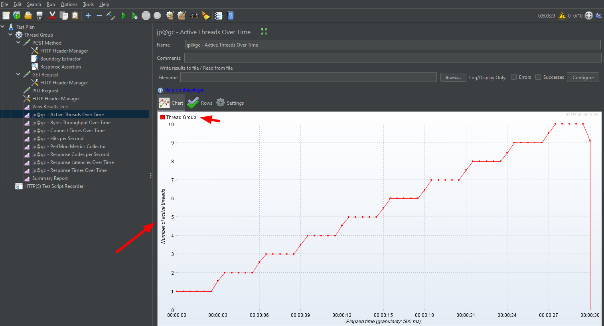
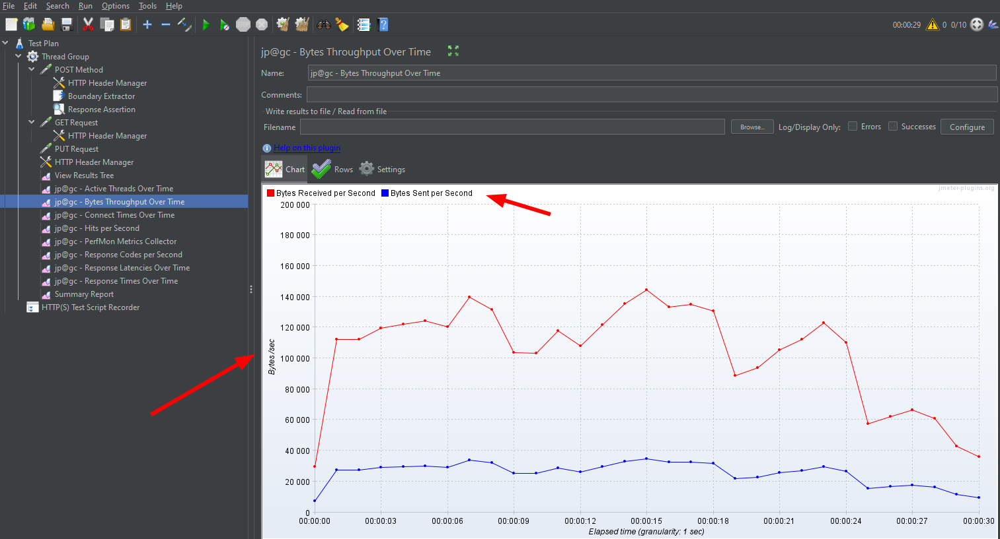
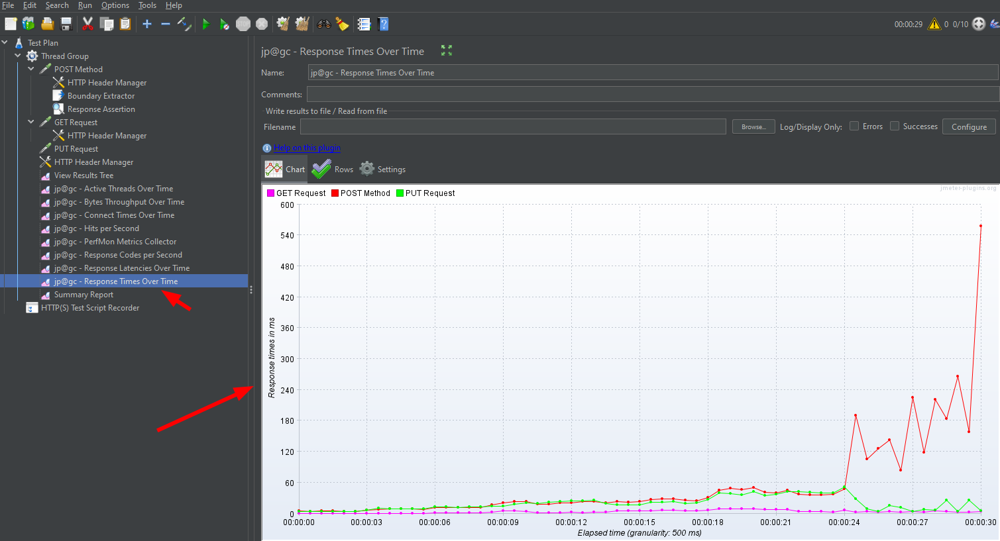

# JMeter Learn

Учебный проект по нагрузочному тестированию API в Apache JMeter: цепочка **POST → извлечение `id` → GET → PUT** выполняется против локального REST API на `json-server`, поэтому лимитов публичных сервисов нет.

## Стек

- Apache JMeter 5.6.3 (GUI)
- JMeter Plugins Manager + `jpgc` (графики Active Threads, Bytes Throughput, Response Times)
- Node.js + `json-server` 1.x
- API: `http://localhost:3000`

## Структура

```
JmeterLearn/
├── Thread Group2.jmx   # тест-план JMeter
├── db.json             # данные локального API (сбрасывается вручную)
├── package.json        # зависимость json-server
├── images/             # скриншоты графиков
└── README.md
```

## Запуск локального API

```powershell
npm install
npx json-server db.json --port 3000
```

Проверка:

```powershell
curl http://localhost:3000/objects
```

Сервер работает с файловым хранилищем `db.json`: POST/PUT/DELETE меняют файл. Для чистого прогона верните `db.json` к исходным трём объектам и перезапустите сервер. Остановить сервер, если порт занят:

```powershell
Get-NetTCPConnection -LocalPort 3000 -State Listen | ForEach-Object { Stop-Process -Id $_.OwningProcess -Force }
```

## Эндпоинты

| Метод  | Путь             | Описание                          |
|--------|------------------|-----------------------------------|
| GET    | `/objects`       | список объектов                   |
| GET    | `/objects/{id}`  | объект по id                      |
| POST   | `/objects`       | создать объект (id генерируется)  |
| PUT    | `/objects/{id}`  | заменить объект                   |
| DELETE | `/objects/{id}`  | удалить объект                    |

## Как устроен тест-план

1. **POST Method** — `POST /objects`, тело в формате JSON, заголовок `Content-Type: application/json`.
2. **JSON Extractor** (`$.id`, Default `NOT_FOUND`) — сохраняет id созданного объекта в переменную `id`. Boundary Extractor тоже возможен, но зависит от порядка полей в ответе: `json-server` возвращает `id` последним.
3. **GET Request** — `GET /objects/${id}`.
4. **PUT Request** — `PUT /objects/${id}` с новым телом.

Параметры подключения для всех сэмплеров: Protocol `http`, Server Name `localhost`, Port `3000`. Порт указывается отдельно, в Server Name писать `localhost:3000` нельзя.

Для отладки корреляции достаточно 1 потока и 1 цикла. Для нагрузки на локальный мок используйте 5–10 потоков: `json-server` — один Node-процесс и не выдерживает сотни одновременных соединений (появляются `Socket closed` и `404` из-за гонок записи `db.json`).

## Запуск теста

GUI: открыть `Thread Group2.jmx`, проверить, что сервер API запущен, нажать Start.

CLI (без GUI):

```powershell
jmeter -n -t "Thread Group2.jmx" -l results.jtl -j jmeter.log
```

## Результаты



*Active Threads Over Time — плавный ramp-up до заданного числа потоков.*



*Bytes Throughput Over Time — входящий и исходящий трафик в секунду.*



*Response Times Over Time — время ответа по каждому сэмплеру (POST, GET, PUT).*

## Типичные ошибки

- `Filename must not be null or empty` — пустой Filename в CSV Data Set Config.
- `Illegal character in path at index ... ${id}` — переменная не извлечена, JMeter подставил `${id}` буквально. Проверьте JSON Extractor и ответ POST.
- `Unrecognized IPv6 address format` — порт вписан в Server Name (`localhost:3000`).
- `405 Method Not Allowed` на `api.restful-api.dev` — исчерпан лимит публичного API (50 запросов/24 ч) или неподдерживаемый метод; в этом проекте используется локальный сервер.
